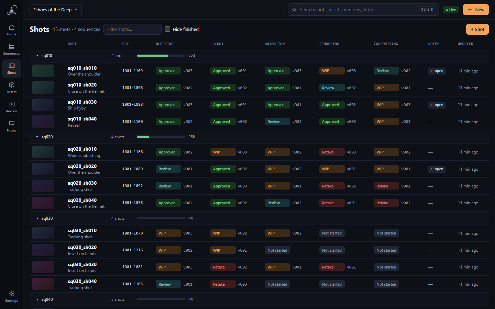
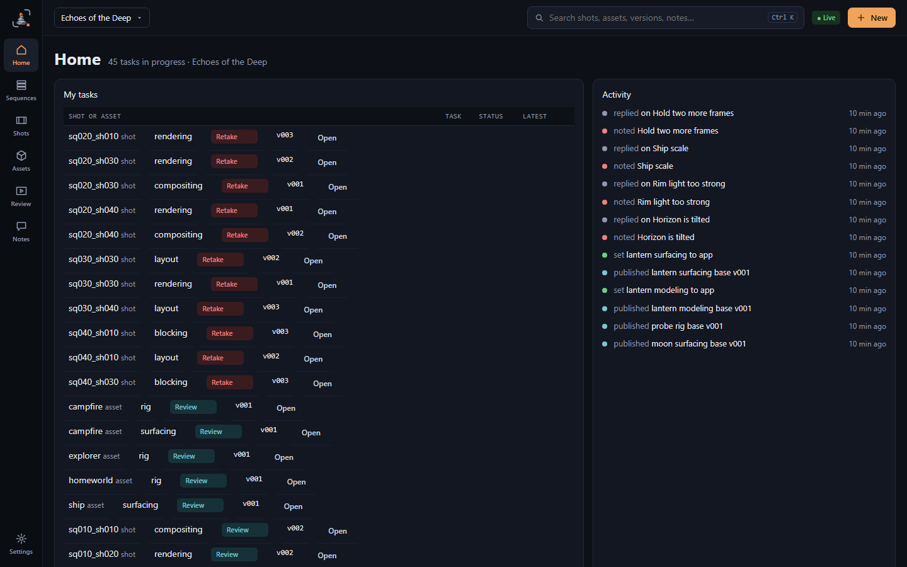
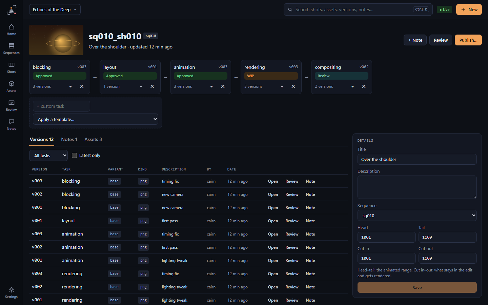
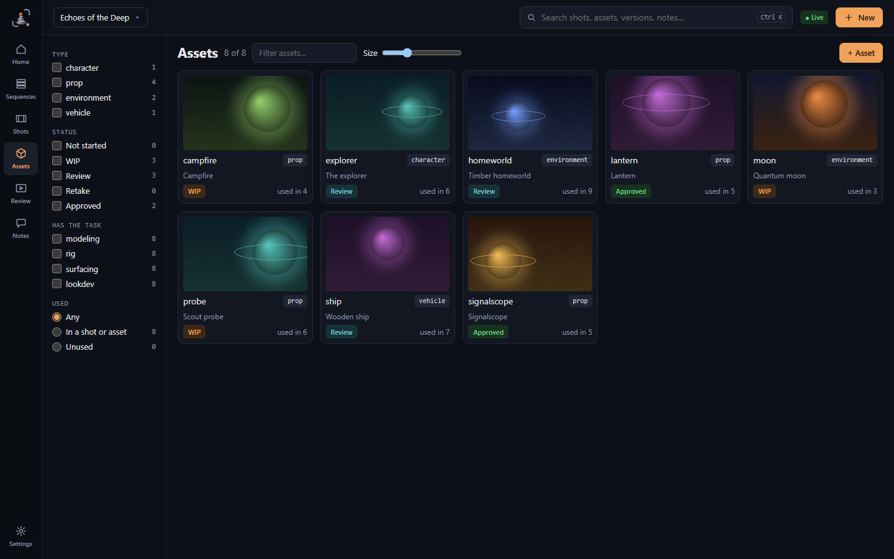
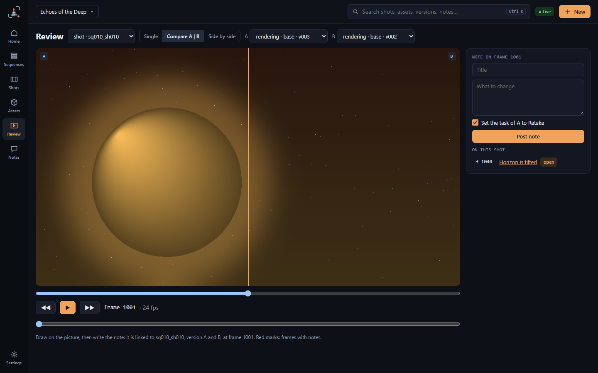
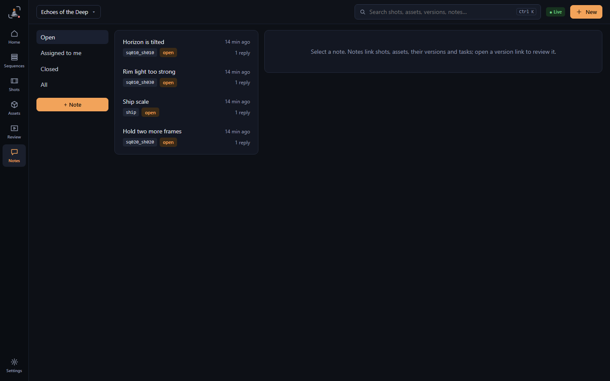

<figure class="cairn-showcase" markdown>

</figure>

Cairn is a server and a web UI. The server keeps the database and the project files; the UI runs in a desktop window or in a browser, so one machine can serve a project to several others.

-   :material-table-large:{ .lg .middle } **Track every shot**

    ---

    One row per shot, one column per task. Statuses change in place, retakes and reviews come first.

-   :material-cube-outline:{ .lg .middle } **An asset library**

    ---

    Characters, props and sets with their pipeline, what they use and where they are used.

-   :material-layers-triple-outline:{ .lg .middle } **Versions you never lose**

    ---

    Every publish is a new file in the project folder, never overwritten. Open it in Blender in one click.

-   :material-compare-horizontal:{ .lg .middle } **Review side by side**

    ---

    Wipe between two versions, step frame by frame, draw on the frame and post the note.

-   :material-message-reply-text-outline:{ .lg .middle } **Notes that stay linked**

    ---

    Threads tied to shots, assets, versions and tasks, with replies, attachments and assignees.

-   :material-puzzle-outline:{ .lg .middle } **Made to be extended**

    ---

    Plugins add their own server routes and their own workspace in the rail. [Write one](plugins.md)

## Slideshow

  

    <button class="cairn-slides__tab is-active" role="tab" aria-selected="true" data-caption="Home: your tasks in progress, retakes and reviews first, and the project's activity.">Home</button>
    <button class="cairn-slides__tab" role="tab" aria-selected="false" data-caption="A shot's page: the task pipeline, its versions and its details.">Shot page</button>
    <button class="cairn-slides__tab" role="tab" aria-selected="false" data-caption="The asset library, filtered by type, status, task and use.">Assets</button>
    <button class="cairn-slides__tab" role="tab" aria-selected="false" data-caption="Review: two versions compared with a wipe, with the notes on this shot.">Review</button>
    <button class="cairn-slides__tab" role="tab" aria-selected="false" data-caption="Notes: threads linked to shots, assets, versions and tasks.">Notes</button>
  

  

    

      
      
      
      
      
    

  

  
Home: your tasks in progress, retakes and reviews first, and the project's activity.

## Not yet

- Login and permissions: the server is single-user, everything is done as "You". Share it on a trusted network only.
- Version-level casting in the UI beyond publishing.
- Installers.
